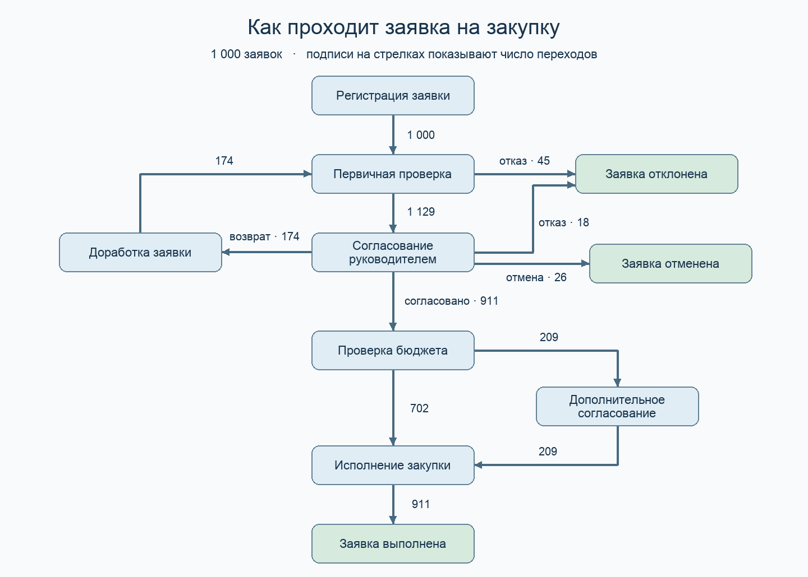

# Восстановление процесса закупки по журналу событий

В журнале 6 508 событий, 1 000 завершённых заявок и восемь полных маршрутов. Все заявки начинаются с регистрации и первичной проверки. Выполнена 911 заявка, отклонены 63, отменены 26. Самый частый маршрут ведёт от регистрации через первичную проверку, руководителя, бюджет и исполнение к успешному завершению. Его прошли 567 заявок (56,7 %).

## Схема наблюдаемых переходов

Число у стрелки — количество переходов между соседними событиями. Повторный проход одной заявки учитывается каждый раз. Подписи развилок передают смысл решения из поля Result.

## Что видно по отдельным историям

- **Возврат.** После доработки заявка снова попадает на первичную проверку. Всего 156 заявок прошли доработку. Из них 138 вернулись один раз, ещё 18 — дважды. Это объясняет 174 перехода по обратной ветви. Пример с двумя возвратами — `0add1ba6-ce33-56cc-95d6-639aceb7dae3`.
- **Дополнительное согласование.** Из 911 исполненных закупок 209 прошли этот этап после бюджета (22,9 %), остальные 702 сразу перешли к исполнению. Обе ветви заканчиваются одинаково. Пример дополнительного согласования без доработки — `78f343a1-28d8-5473-b013-17207d09ffa8`.
- **Отказ и отмена.** Среди 63 отказов 45 произошли при первичной проверке и 18 у руководителя. Все 26 отмен следуют за решением руководителя. Пример отказа на первичной проверке — `c7f440c6-2f22-531e-9053-ae0d7a89b19b`.
- **Обязательность этапов.** Регистрация и первичная проверка есть во всех историях. Бюджет и исполнение есть во всех успешно завершённых и отсутствуют в отказах и отменах. Полные последовательности с повторами, числом заявок и долей от общей выборки приведены в [таблице вариантов](variants.csv).

## Метод и границы вывода

Строки сгруппированы по ProcessInstanceId и отсортированы по числовому EventIndex. Для каждого экземпляра сохранена последовательность ActivityName, включая начало, конец и повторные задания. Одинаковые последовательности объединены. Для схемы отдельно подсчитаны соседние пары действий. Контрольная сумма частот стрелок равна 5 508, то есть числу событий за вычетом одного начала на каждую заявку.

Граф позволяет пройти цикл трижды или после доработки завершить процесс отменой. В восьми фактических маршрутах таких историй нет. Поэтому для оценки распространённости конкретного сценария нужна таблица полных маршрутов. По одним завершениям заданий нельзя установить точное время работы сотрудника или внутреннюю настройку шлюза.

Код и текст подготовлены с помощью ИИ. Числа получены запуском [скрипта](analyze.py) на исходном CSV. Для повторения выполните в этой папке `python3 analyze.py "/путь/к/кейс 2 ЭЛМА/students.csv"`. Скрипт проверяет порядок событий и границы экземпляров, создаёт таблицу вариантов и [перечень переходов](student_transitions.csv).
